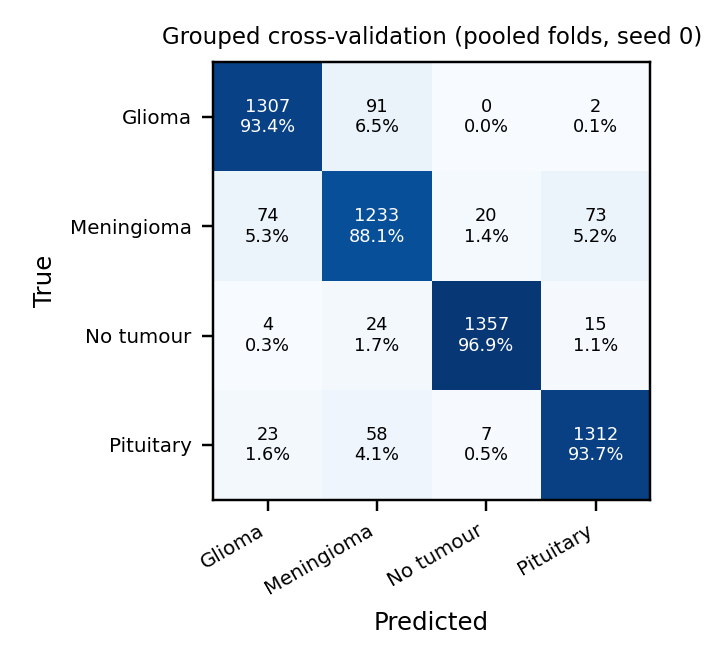
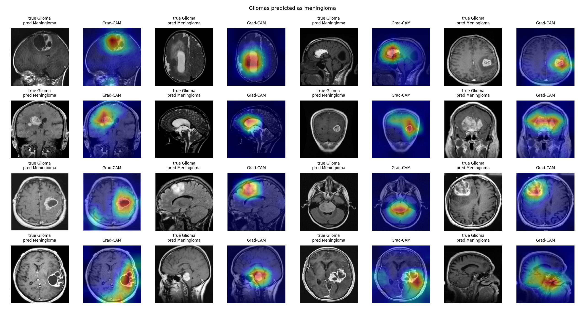

# Brain Tumor MRI Leakage Benchmark

*A leakage- and source-aware evaluation of compact transfer-learning CNNs for four-class brain-tumour MRI classification (glioma, meningioma, pituitary tumour, no tumour).*


-8A2BE2)


**Tech stack & skills:** Python · PyTorch · torchvision · scikit-learn · NumPy · pandas · SciPy · matplotlib — data auditing, perceptual hashing, near-duplicate detection, patient-level linkage, grouped cross-validation, transfer learning, model benchmarking, calibration, Grad-CAM saliency, shortcut-learning probes, CPU latency benchmarking.

> **Disclaimer.** This is a research project, not a medical device. The models must not be used for clinical diagnosis.

---

## Contents

1. [Project overview](#project-overview)
2. [Results at a glance](#results-at-a-glance)
3. [Project structure](#project-structure)
4. [Dataset and leakage audit](#dataset-and-leakage-audit)
5. [Methods](#methods)
6. [Results](#results)
   - [Cross-validation](#1-cross-validation-grouped-versus-image-level-splitting)
   - [Baselines and ablations](#2-lightweight-cnns-and-training-ablations)
   - [Official test partition](#3-official-test-partition)
   - [Results by duplicate status and image source](#4-results-by-duplicate-status-and-image-source)
   - [Glioma errors](#5-glioma-errors)
   - [Calibration, shortcut probes and saliency](#6-calibration-shortcut-probes-and-saliency)
   - [Computational cost](#7-computational-cost)
7. [Comparison with published studies](#comparison-with-published-studies)
8. [Key findings](#key-findings)
9. [Requirements](#requirements)
10. [Setup and run](#setup-and-run)
11. [Reproducing every table and figure](#reproducing-every-table-and-figure)
12. [Limitations](#limitations)
13. [Citation](#citation)
14. [License](#license)

---

## Project overview

The Kaggle *Brain Tumor MRI Dataset* (Nickparvar) is one of the most widely used public benchmarks for four-class brain-tumour classification, and accuracies of 95–99% are routinely reported on it. This repository asks a simple question: **how much of that performance survives when data leakage and source-related shortcuts are controlled?**

It contains the complete, reproducible pipeline and every result of the study *"Four-class brain-tumour MRI classification with a compact EfficientNet: a leakage-aware evaluation"* (A. Irshad, under review at *Biomedical Physics & Engineering Express*):

1. **Dataset audit** — class counts, exact duplicates, rotation/reflection-invariant near-duplicates, recovered patient identifiers, label conflicts and the image source of every class.
2. **Leakage-aware evaluation** — duplicate- and patient-grouped 5-fold cross-validation repeated over 3 seeds, compared directly with conventional image-level splitting.
3. **Controlled benchmark** — EfficientNet-B0 versus ResNet-18, MobileNetV3-Large and ShuffleNetV2, plus two training ablations, all under identical conditions.
4. **Failure analysis** — test performance by duplicate status and image source, calibration, occlusion and metadata-only shortcut probes, and Grad-CAM for every misclassified glioma.
5. **Measured efficiency** — parameters, GFLOPs and wall-clock CPU latency with full hardware details.

> **Main finding.** 67.7–88.5% of the official test images have a duplicate or same-patient twin in the training data. The model scores **98.6%** on those but **67.9%** on test images without a twin. All training gliomas come from a single source, and gliomas from other sources are recognised in only **21.9%** of cases — almost a third are called "no tumour" with high confidence. Near-ceiling accuracy on this benchmark largely reflects duplicated images and source-specific cues.

---

## Results at a glance

| Quantity | Value |
|:--|:--:|
| Official test images with a training twin (NCC ≥ 0.98 → NCC ≥ 0.95 + patient links) | **67.7% – 88.5%** |
| Grouped 5-fold CV accuracy, EfficientNet-B0 (15 runs) | **93.4 ± 1.9%** (95% CI 91.1–95.7) |
| Image-level 5-fold CV accuracy (conventional protocol) | 97.7 ± 0.7% |
| Official test accuracy (3 final models) | 95.1 ± 0.7% |
| — on test images **with** a training twin (n = 1,416) | **98.6 ± 0.5%** |
| — on test images **without** a training twin (n = 184) | **67.9 ± 2.7%** |
| Glioma recall, figshare-source gliomas (n = 324) | 96.5 ± 1.2% |
| Glioma recall, other-source gliomas (n = 76) | **21.9 ± 4.0%** |
| Other-source gliomas called "no tumour" | 31.6 ± 3.9% (median confidence 0.987) |
| Tumour vs no tumour from file properties only (grouped CV) | 91.1 ± 3.0% balanced accuracy |
| CPU latency, EfficientNet-B0 (Xeon 2.0 GHz, 2 threads, batch 1) | 41.5 ms / image |

---

## Project structure

```
Brain-Tumor-MRI-Leakage-Benchmark/
├── README.md
├── LICENSE
├── CITATION.cff
├── requirements.txt
├── .gitignore
├── data/
│   └── README.md                  # how to download the datasets (not redistributed here)
├── notebooks/
│   └── run_all.ipynb              # one-click pipeline for Kaggle / Colab
├── scripts/
│   ├── common.py                  # data loading, models, training, metrics (shared)
│   ├── s00_audit.py               # dataset accounting and release detection
│   ├── s01_dedup.py               # exact / near-duplicate / patient-level audit
│   ├── s02_cv.py                  # grouped and image-level cross-validation
│   ├── s03_test.py                # final models on the official test partition
│   ├── s04_explain.py             # occlusion probes, Grad-CAM, glioma error analysis
│   ├── s05_latency.py             # parameters, GFLOPs, measured CPU latency
│   ├── s06_report.py              # aggregates every run into summary values and figures
│   └── s07_source_analysis.py     # results by duplicate status and image source
├── results/                       # every per-run result of the study (JSON / CSV)
│   ├── audit_summary.json, dedup_summary.json, groups.csv, duplicate_links.csv, ...
│   ├── dedup_098/                 # sensitivity analysis at NCC >= 0.98
│   ├── cv/grouped/, cv/naive/     # one JSON per (model, mode, seed, fold)
│   ├── test/                      # final models: metrics and per-image predictions
│   └── explain/                   # occlusion, metadata probe, glioma error tables
├── figures/                       # all figures of the paper (fig01–fig08)
└── tables/                        # main tables of the paper as CSV
```

---

## Dataset and leakage audit

**Brain Tumor MRI Dataset, version 2** (M. Nickparvar, Kaggle) — 7,200 two-dimensional MRI slices supplied as a training and a test partition. The collection merges the figshare dataset of Cheng *et al.* with the SARTAJ and Br35H collections. Images are not redistributed here; see [`data/README.md`](data/README.md).

| Class | Training (figshare-source) | Test (figshare-source) | Test with training twin¹ | Test with near-twin² | Test without twin |
|:--|:--:|:--:|:--:|:--:|:--:|
| Glioma | 1,400 (1,400) | 400 (324) | 326 | 119 | 74 |
| Meningioma | 1,400 (1,181) | 400 (186) | 292 | 271 | 108 |
| No tumour | 1,400 (0) | 400 (0) | 400 | 398 | 0 |
| Pituitary | 1,400 (1,344) | 400 (400) | 398 | 295 | 2 |
| **Total** | **5,600 (3,925)** | **1,600 (910)** | **1,416 (88.5%)** | **1,083 (67.7%)** | **184** |

¹ exact copy, near-duplicate (NCC ≥ 0.95, any rotation/reflection) or same patient. ² near-duplicate at the stricter NCC ≥ 0.98, without patient links.

| Leakage audit | Value |
|:--|:--:|
| Exact-duplicate pairs (MD5 of pixels) | 322 |
| Near-duplicate pairs (NCC ≥ 0.95) | 23,398 |
| Slices matched to a figshare patient ID | 4,835 (233 patients) |
| Multi-image groups | 504 groups, 6,758 images (93.9%) |
| Training images with a twin inside the training partition | 93.1% |
| Median NCC of cross-partition pairs | 0.997 |
| Cross-partition pairs joining different labels | 4 of 9,255 |
| Groups containing conflicting labels | 4 groups (46 images) |
| Training no-tumour images that are 512 × 512 | 1.2% (vs 100% of training gliomas) |

<p align="center"></p>
<p align="center"><em>Figure 1. Cross-partition pairs close to the 0.95 NCC threshold (top: training, bottom: test). Pairs at this threshold are similar but not identical slices, so contamination is reported at both 0.95 and 0.98.</em></p>

---

## Methods

| Component | Setting |
|:--|:--|
| Input | RGB, 224 × 224, ImageNet normalisation |
| Backbones | EfficientNet-B0 (main), ResNet-18, MobileNetV3-Large, ShuffleNetV2 1.0× — ImageNet-pretrained (torchvision) |
| Head | global average pooling → dropout 0.2 → linear (4 classes) |
| Stage 1 | head only, ≤ 15 epochs, lr 1 × 10⁻³, backbone frozen (BN in inference mode) |
| Stage 2 | whole network, ≤ 30 epochs, lr 5 × 10⁻⁵ |
| Ablations | frozen backbone (≤ 45 epochs, lr 1 × 10⁻³); single-stage (≤ 45 epochs, lr 1 × 10⁻⁴) |
| Optimiser / loss | Adam, cross-entropy, batch 32 |
| Early stopping | patience 8 on a group-aware 15% validation split of the training data |
| Augmentation | horizontal flip, rotation ±10°, resized crop (0.90–1.00), brightness/contrast ±10%; no TTA |
| Leakage detection | MD5; 64-bit DCT pHash over 8 rotations/reflections (Hamming ≤ 8); NCC ≥ 0.95 on 64 × 64 thumbnails; figshare patient IDs; union–find groups |
| Cross-validation | stratified group 5-fold, seeds 0/1/2 (15 runs); image-level 5-fold for comparison |
| Statistics | mean ± SD over runs; CI of the CV mean by the Nadeau–Bengio corrected resampled *t*; test bootstrap CI (2,000 class-stratified resamples) |
| Hardware / software | NVIDIA Tesla T4; Python 3.13, PyTorch 2.11, torchvision 0.26; fixed seeds, deterministic cuDNN |

---

## Results

### 1. Cross-validation: grouped versus image-level splitting

| Protocol | Runs | Accuracy (%) [95% CI] | Balanced acc. (%) | Macro-F1 [95% CI] | Macro-AUC [95% CI] | ECE |
|:--|:--:|:--:|:--:|:--:|:--:|:--:|
| Grouped (duplicates + patients) | 15 | **93.4 ± 1.9** [91.1–95.7] | 93.4 ± 1.8 | 0.933 ± 0.018 [0.911–0.955] | 0.990 ± 0.008 [0.980–1.000] | 0.038 |
| Image-level (conventional) | 5 | 97.7 ± 0.7 [96.4–98.9] | 97.7 ± 0.7 | 0.977 ± 0.007 [0.964–0.989] | 0.999 ± 0.001 [0.997–1.000] | 0.011 |

Image-level splitting overestimates accuracy by **4.3 percentage points** (4.7 points when compared with the grouped runs that used the same seed).

| Class (grouped CV) | Precision | Recall | F1 |
|:--|:--:|:--:|:--:|
| Glioma | 0.933 ± 0.034 | 0.938 ± 0.041 | 0.935 ± 0.022 |
| Meningioma | 0.891 ± 0.045 | 0.885 ± 0.067 | 0.886 ± 0.041 |
| No tumour | 0.978 ± 0.016 | 0.975 ± 0.016 | 0.976 ± 0.011 |
| Pituitary | 0.932 ± 0.053 | 0.939 ± 0.032 | 0.935 ± 0.028 |

<p align="center"></p>
<p align="center"><em>Figure 2. Accuracy of every cross-validation run (dots) with mean ± SD.</em></p>

<p align="center"></p>
<p align="center"><em>Figure 3. Confusion matrix pooled over the five grouped folds (seed 0).</em></p>

### 2. Lightweight CNNs and training ablations

| Model / training | Params (M) | GFLOPs | CPU ms | CV accuracy (%) | CV macro-F1 | CV glioma recall | No-twin test acc. (%) | No-twin glioma recall |
|:--|:--:|:--:|:--:|:--:|:--:|:--:|:--:|:--:|
| EfficientNet-B0, two-stage | 4.01 | 0.77 | 41.5 | 93.4 ± 1.9 | 0.933 | 0.938 | 67.9 | 0.225 |
| EfficientNet-B0, single-stage | 4.01 | 0.77 | 41.5 | 94.3 ± 2.2 | 0.943 | 0.935 | 67.9 | 0.230 |
| EfficientNet-B0, frozen backbone | 4.01 | 0.77 | 41.5 | 88.6 ± 2.2 | 0.886 | 0.861 | 58.7 | 0.243 |
| MobileNetV3-Large, two-stage | 4.21 | 0.43 | 24.7 | 92.8 ± 2.6 | 0.928 | 0.916 | 64.1 | 0.149 |
| ShuffleNetV2 1.0×, two-stage | 1.26 | 0.29 | 22.3 | 92.5 ± 2.2 | 0.924 | 0.930 | 59.8 | 0.095 |
| ResNet-18, two-stage | 11.18 | 3.63 | 37.2 | 91.4 ± 2.0 | 0.913 | 0.943 | 55.4 | 0.081 |

The compact architectures perform within run-to-run variation, full fine-tuning clearly beats a frozen backbone, the two-stage warm-up adds nothing over single-stage training, and **every model fails on gliomas without a training twin**.

### 3. Official test partition

| Test set | Images | Accuracy (%) [95% CI] | Balanced acc. (%) | Macro-F1 [95% CI] | Macro-AUC [95% CI] | ECE |
|:--|:--:|:--:|:--:|:--:|:--:|:--:|
| Official test partition | 1,600 | 95.1 ± 0.7 [94.9–96.8] | 95.1 ± 0.7 | 0.950 ± 0.008 [0.947–0.968] | 0.990 ± 0.002 [0.990–0.996] | 0.030 |

| Class (official test) | Precision | Recall | F1 |
|:--|:--:|:--:|:--:|
| Glioma | 0.993 ± 0.006 | **0.823 ± 0.018** | 0.900 ± 0.013 |
| Meningioma | 0.896 ± 0.010 | 0.980 ± 0.011 | 0.936 ± 0.011 |
| No tumour | 0.940 ± 0.011 | 1.000 ± 0.000 | 0.969 ± 0.006 |
| Pituitary | 0.988 ± 0.002 | 1.000 ± 0.000 | 0.994 ± 0.001 |

<p align="center"></p>
<p align="center"><em>Figure 4. Confusion matrices on the official test partition and on test images without a training twin.</em></p>

### 4. Results by duplicate status and image source

| Subset of the official test partition | Images | Accuracy (%) | Glioma recall (%) | Gliomas → "no tumour" (%) | Gliomas → "meningioma" (%) |
|:--|:--:|:--:|:--:|:--:|:--:|
| All | 1,600 | 95.1 ± 0.7 | 82.3 ± 1.8 | 6.0 ± 0.8 | 11.4 ± 1.1 |
| With a training twin | 1,416 | **98.6 ± 0.5** | 95.9 ± 1.2 | 0.0 | 4.0 ± 1.2 |
| Without a training twin | 184 | **67.9 ± 2.7** | 22.5 ± 4.1 | 32.4 ± 4.1 | 44.1 ± 0.8 |
| Without a near-duplicate (NCC ≥ 0.98) | 517 | 86.5 ± 1.5 | 76.4 ± 2.0 | 8.5 ± 1.1 | 14.7 ± 1.1 |
| Gliomas, figshare source | 324 | — | **96.5 ± 1.2** | 0.0 | 3.4 ± 1.2 |
| Gliomas, other sources | 76 | — | **21.9 ± 4.0** | 31.6 ± 3.9 | 45.6 ± 0.8 |

<p align="center"></p>
<p align="center"><em>Figure 5. Accuracy with and without a training twin, and glioma recall by image source (mean ± SD, 3 seeds).</em></p>

### 5. Glioma errors

- Of the 63 glioma errors of the seed-0 model, **56 are other-source gliomas**, including **all 21** gliomas called "no tumour" (median confidence 0.987).
- Excluding the 76 other-source gliomas, official test accuracy would be 98.7 ± 0.6%.
- The missed gliomas mostly show large, clearly visible lesions on T2-weighted/FLAIR images or coronal/sagittal slices — acquisition types absent from the training gliomas; at least one appears to be a CT scan.

<p align="center"></p>
<p align="center"><em>Figure 6(a). Gliomas classified as "no tumour", with Grad-CAM maps. All are other-source images.</em></p>

<p align="center"></p>
<p align="center"><em>Figure 6(b). Gliomas classified as "meningioma", with Grad-CAM maps.</em></p>

### 6. Calibration, shortcut probes and saliency

| Probe | Result |
|:--|:--:|
| ECE, official test partition | 0.030 ± 0.003 |
| ECE, test images without a training twin | 0.236 ± 0.016 (overconfident) |
| Accuracy on no-twin images: unmasked → centre 60% masked → only centre kept | 70.7% → 26.6% → 61.4% |
| File-properties-only random forest, tumour vs no tumour (grouped CV / test) | 91.1 ± 3.0% / 95.2% balanced accuracy |
| File-properties-only random forest, four classes (grouped CV / test) | 63.8 ± 2.3% / 61.8% balanced accuracy |

<p align="center"> &nbsp; </p>
<p align="center"><em>Figure 7 (left). Reliability on test images without a training twin. Figure 8 (right). Grad-CAM for correctly classified images.</em></p>

### 7. Computational cost

| Model | Params (M) | GFLOPs | Weights (MB) | CPU latency, batch 1 (ms) |
|:--|:--:|:--:|:--:|:--:|
| EfficientNet-B0 | 4.01 | 0.77 | 16.3 | 41.5 (p95 43.8) |
| MobileNetV3-Large | 4.21 | 0.43 | 17.0 | 24.7 |
| ShuffleNetV2 1.0× | 1.26 | 0.29 | 5.2 | 22.3 |
| ResNet-18 | 11.18 | 3.63 | 44.8 | 37.2 |

Intel Xeon CPU @ 2.00 GHz, 2 threads, PyTorch 2.11, fp32, median of 200 runs after 20 warm-up runs. CPU latency does not follow GFLOPs: ResNet-18 needs 4.7× the operations of EfficientNet-B0 yet runs faster.

---

## Comparison with published studies

| Study | Release (images) | Splitting | Leakage control | Reported result |
|:--|:--:|:--|:--|:--|
| Gómez-Guzmán *et al.* 2023 | v1 (7,023) | image-level 5-fold CV | none reported | InceptionV3 97.1% (CV) |
| Disci *et al.* 2025 | v1 (7,023) | official split; no CV | none reported | Xception 95.3% (test) |
| Gorenshtein *et al.* 2026 | v1 (7,023) | official split; 5-fold CV for tuning | "patient-wise" stated, not described | ResNet family 98.5–99.2% |
| Uthra & Sivashankari 2026 | v2 (7,200) | image-level 5-fold CV + official test | none | ensemble 95.5% (test) |
| Duong *et al.* 2026 | v2 (7,200) | duplicate- and patient-grouped 5-fold CV | MD5 + pHash + NCC; patient IDs | EfficientNet-B0 94.5% (CV) |
| Vangala *et al.* 2026 | v2 test (1,600) | audit of the official split | NCC ≥ 0.98; patient IDs | 28.8% of test images leak |
| **This work** | v2 (7,200) | grouped 5-fold CV × 3 seeds; test by twin status and source | MD5 + pHash + NCC; patient IDs | **93.4% (CV); 67.9% without a twin** |

Only results obtained with grouped splitting of the same release are directly comparable; our grouped estimate agrees with Duong *et al.*

---

## Key findings

- **Leakage is severe.** Between two-thirds and nine-tenths of the official test images have a duplicate or same-patient twin in the training partition.
- **Image-level splitting inflates accuracy** by 4.3–4.7 points compared with grouped splitting.
- **Official test accuracy (95.1%) is mostly recognition** of seen images: 98.6% with a twin versus 67.9% without.
- **Class is confounded with image source.** Every training glioma comes from one source; gliomas from other sources are recognised in only 21.9% of cases, and 31.6% are confidently called "no tumour".
- **Architecture is not the bottleneck.** Four compact CNNs behave alike; the limiting factor is the data.
- **Lesson for multi-source datasets:** control leakage by duplicates, patients *and* image source, and report results per source.

---

## Requirements

- Python 3.10+
- An NVIDIA GPU for training (a free Kaggle or Colab GPU is enough; about 9–11 GPU hours for the full study)
- Packages in [`requirements.txt`](requirements.txt): `torch`, `torchvision`, `numpy`, `pandas`, `scipy`, `scikit-learn`, `pillow`, `matplotlib`, `h5py`, `onnx`, `onnxruntime`, `onnxscript`

---

## Setup and run

### Option 1 — Kaggle (recommended)

1. Create a new Kaggle notebook and import [`notebooks/run_all.ipynb`](notebooks/run_all.ipynb).
2. **Add Input →** `masoudnickparvar/brain-tumor-mri-dataset` (version 2, 1,400/400 images per class).
3. **Settings →** Accelerator: *GPU*; Internet: *On* (for ImageNet weights and the figshare patient-ID files).
4. **Save Version → Save & Run All (Commit).** The notebook clones this repository, runs every step and saves `results.zip` to the *Output* tab. Attach a previous output to resume an interrupted run.

### Option 2 — Locally / Google Colab

```bash
git clone https://github.com/Asadullah-Irshad/Brain-Tumor-MRI-Leakage-Benchmark.git
cd Brain-Tumor-MRI-Leakage-Benchmark
python -m venv .venv && source .venv/bin/activate      # Windows: .venv\Scripts\activate
pip install -r requirements.txt

DATA=/path/to/brain-tumor-mri-dataset     # folder that contains Training/ and Testing/
FIG=/path/to/figshare_mat_files           # Cheng et al. .mat files (patient IDs)
OUT=results_new
G="--data_root $DATA --groups $OUT/groups.csv --out $OUT"

python scripts/s00_audit.py --data_root $DATA --out $OUT
python scripts/s01_dedup.py --data_root $DATA --out $OUT --figshare_dir $FIG
python scripts/s01_dedup.py --data_root $DATA --out $OUT/dedup_098 --ncc_thr 0.98
python scripts/s02_cv.py $G --models efficientnet_b0 --modes two_stage --seeds 0 1 2 --protocol grouped
python scripts/s02_cv.py $G --models efficientnet_b0 --modes two_stage --seeds 0 --protocol naive
python scripts/s02_cv.py $G --models resnet18 mobilenet_v3_large shufflenet_v2_x1_0 --modes two_stage --seeds 0
python scripts/s02_cv.py $G --models efficientnet_b0 --modes frozen single_stage --seeds 0
python scripts/s03_test.py $G --models efficientnet_b0 --modes two_stage --seeds 0 1 2
python scripts/s03_test.py $G --models resnet18 mobilenet_v3_large shufflenet_v2_x1_0 --modes two_stage --seeds 0
python scripts/s03_test.py $G --models efficientnet_b0 --modes frozen single_stage --seeds 0
python scripts/s04_explain.py $G --model efficientnet_b0 --mode two_stage --seed 0
python scripts/s05_latency.py --out $OUT --weights $OUT/test/efficientnet_b0__two_stage__s0.pt
python scripts/s06_report.py --out $OUT --data_root $DATA
python scripts/s07_source_analysis.py --out $OUT
```

Every training step is resumable: a finished (model, mode, seed, fold) is skipped when the command is re-run. Add `--smoke` to any training script for a fast end-to-end check on CPU.

To regenerate the source analysis, Table 8 and Figures 4, 5 and 7 from the published results **without retraining**:

```bash
python scripts/s07_source_analysis.py --out results
```

---

## Reproducing every table and figure

| Paper item | Repository file | Produced by |
|:--|:--|:--|
| Table 2 — image accounting and sources | `tables/table2_image_accounting_and_sources.csv` | `s00_audit.py`, `s01_dedup.py`, `s07_source_analysis.py` |
| Table 3 — cross-validation | `tables/table3_cross_validation.csv` | `s02_cv.py` → `s06_report.py` |
| Table 4 — per-class CV | `results/manuscript_values.json` (`CV_*`) | `s06_report.py` |
| Table 5 — baselines and ablations | `tables/table5_baselines_and_ablations.csv` | `s02_cv.py`, `s03_test.py`, `s05_latency.py` |
| Tables 6–7 — official test | `tables/table6_official_test.csv`, `results/manuscript_values.json` (`T_*`) | `s03_test.py` → `s06_report.py` |
| Table 8 — subsets by twin and source | `tables/table8_test_subsets_by_twin_and_source.csv` | `s07_source_analysis.py` |
| Figure 1 | `figures/fig01_near_duplicate_pairs.png` | `s06_report.py` |
| Figures 2–3 | `figures/fig02_cv_runs.png`, `figures/fig03_cv_confusion.png` | `s06_report.py` |
| Figures 4, 5, 7 | `figures/fig04_test_confusion.png`, `fig05_source_effect.png`, `fig07_reliability.png` | `s07_source_analysis.py` |
| Figures 6a, 6b, 8 | `figures/fig06a_glioma_to_no_tumour.png`, `fig06b_glioma_to_meningioma.png`, `fig08_gradcam_correct.png` | `s04_explain.py` |
| All summary numbers | `results/manuscript_values.json`, `results/source_analysis.json` | `s06_report.py`, `s07_source_analysis.py` |

In `results/`, files named `*__clean_*` refer to test images without a training twin.

---

## Limitations

- No independently collected external cohort; the other-source gliomas act as an out-of-source test for one class only.
- Patient identifiers are recoverable only for figshare-source slices, so residual patient overlap cannot be excluded for other images.
- At NCC ≥ 0.95 some similar but distinct slices are linked; contamination is therefore reported at both 0.95 and 0.98.
- Two-dimensional slices only (no volumetric context), downsampled to 224 × 224.
- Balanced classes do not reflect clinical prevalence; labels come from the dataset curators.
- One fixed training recipe; no hyperparameter tuning, test-time augmentation, larger models or reader study.

---

## Citation

If you use this code, the duplicate lists or the grouped splits, please cite the repository (see [`CITATION.cff`](CITATION.cff), or use **"Cite this repository"** on GitHub):

```bibtex
@software{irshad2026leakagebenchmark,
  author  = {Irshad, Asadullah},
  title   = {Brain Tumor MRI Leakage Benchmark},
  year    = {2026},
  version = {1.0.0},
  url     = {https://github.com/Asadullah-Irshad/Brain-Tumor-MRI-Leakage-Benchmark},
  license = {MIT}
}

@unpublished{irshad2026bpex,
  author = {Irshad, Asadullah},
  title  = {Four-class brain-tumour {MRI} classification with a compact {EfficientNet}: a leakage-aware evaluation},
  note   = {Manuscript under review at Biomedical Physics \& Engineering Express},
  year   = {2026}
}
```

Please also cite the dataset: Nickparvar, M. (2021). *Brain Tumor MRI Dataset*. Kaggle. https://doi.org/10.34740/kaggle/dsv/2645886

**Author:** Asadullah Irshad — Centre of Excellence for Data Science, Artificial Intelligence and Modelling (DAIM), University of Hull · ORCID [0009-0005-5068-6404](https://orcid.org/0009-0005-5068-6404)

## License

Code released under the [MIT License](LICENSE). The image datasets are **not** included and remain under their own licences.
