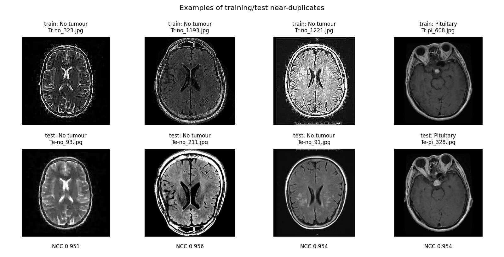
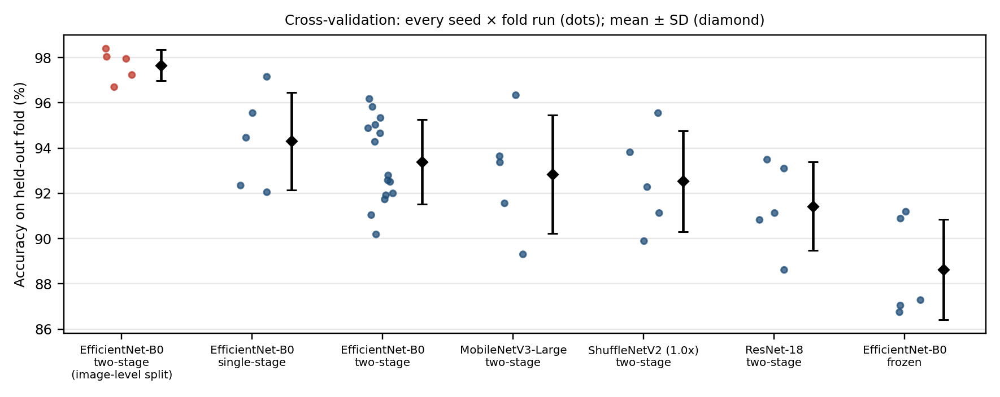
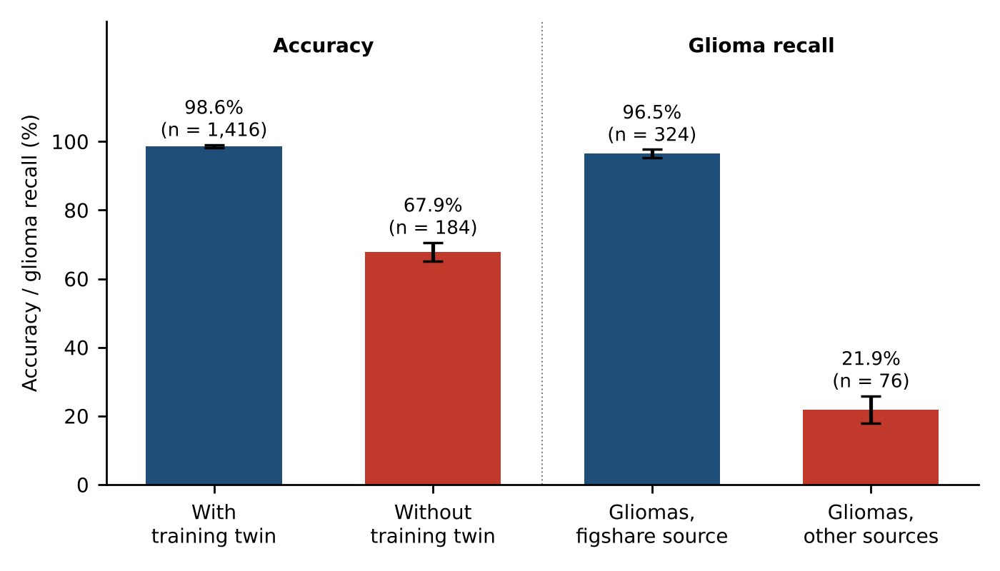
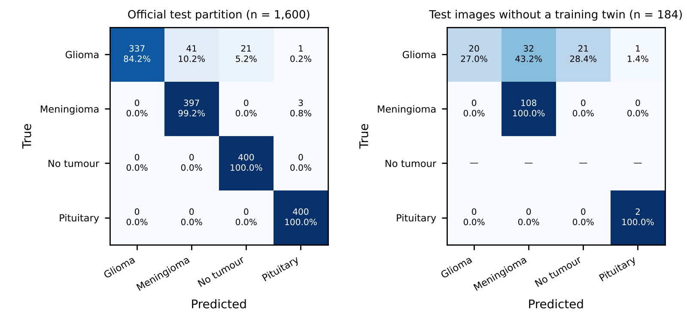
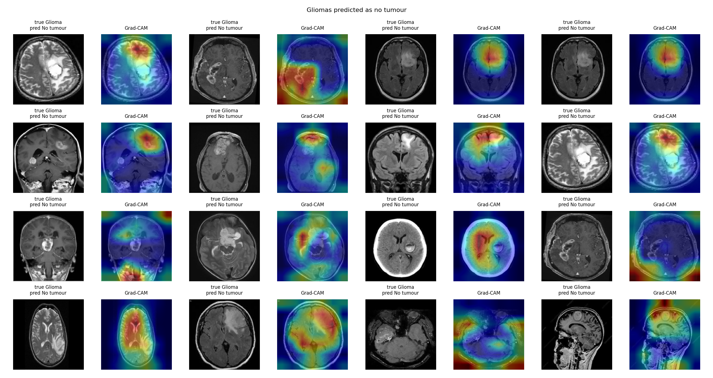
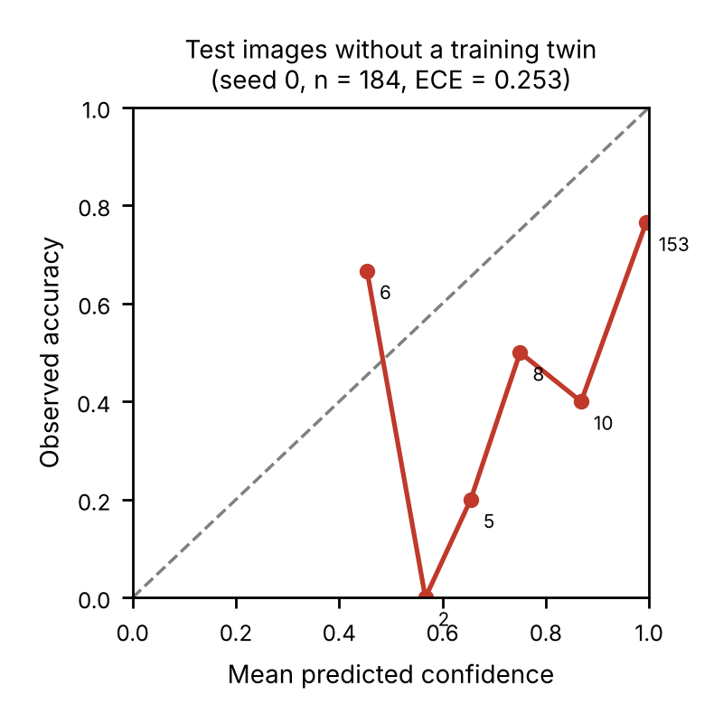
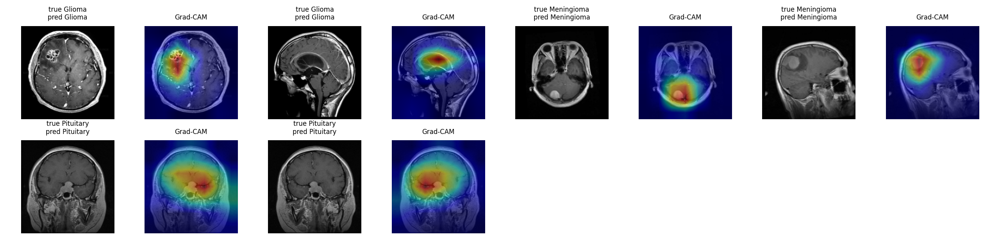

# Brain Tumor MRI Leakage Benchmark

*A leakage- and source-aware benchmark of compact transfer-learning CNNs for four-class brain-tumour MRI classification (glioma, meningioma, pituitary tumour, no tumour).*


**Tech stack & skills:** Python · PyTorch · torchvision · scikit-learn · NumPy · pandas · SciPy · matplotlib — data auditing, perceptual hashing, near-duplicate detection, patient-level linkage, grouped cross-validation, transfer learning, model benchmarking, calibration, Grad-CAM saliency, shortcut-learning probes, CPU latency benchmarking.

---

## Project overview

The Kaggle *Brain Tumor MRI Dataset* (Nickparvar) is one of the most widely used public benchmarks for four-class brain-tumour classification, and accuracies of 95–99% are routinely reported on it. This repository asks a simple question: **how much of that performance survives when data leakage and source-related shortcuts are controlled?**

It contains the complete, reproducible pipeline and all results for the study *"Four-class brain-tumour MRI classification with a compact EfficientNet: a leakage-aware evaluation"* (A. Irshad, under review at *Biomedical Physics & Engineering Express*):

1. **Dataset audit:** class counts, exact duplicates, rotation/reflection-invariant near-duplicates, recovered patient identifiers, label conflicts and the image source of every class.
2. **Leakage-aware evaluation:** duplicate- and patient-grouped 5-fold cross-validation repeated over 3 seeds, compared directly with conventional image-level splitting.
3. **Controlled benchmark:** EfficientNet-B0 versus ResNet-18, MobileNetV3-Large and ShuffleNetV2, plus two training ablations, all under identical conditions.
4. **Failure analysis:** test performance by duplicate status and by image source, calibration, occlusion and metadata-only shortcut probes, and Grad-CAM for every misclassified glioma.
5. **Measured efficiency:** parameters, GFLOPs and wall-clock CPU latency with full hardware details.

> **Main finding.** 67.7–88.5% of the official test images have a duplicate or same-patient twin in the training data. The model scores **98.6%** on those but **67.9%** on test images without a twin. All training gliomas come from a single source, and gliomas from other sources are recognised in only **21.9%** of cases — almost a third are called "no tumour" with high confidence. Near-ceiling accuracy on this benchmark largely reflects duplicated images and source-specific cues.

> **Disclaimer.** This is a research project, not a medical device. The models must not be used for clinical diagnosis.

---

## Project structure

```
Brain-Tumor-MRI-Leakage-Benchmark/
├── README.md
├── LICENSE
├── CITATION.cff
├── requirements.txt
├── .gitignore
├── data/
│   └── README.md                  # how to download the datasets (not redistributed here)
├── notebooks/
│   └── run_all.ipynb              # one-click pipeline for Kaggle / Colab
├── scripts/
│   ├── common.py                  # data loading, models, training, metrics (shared)
│   ├── s00_audit.py               # dataset accounting and release detection
│   ├── s01_dedup.py               # exact / near-duplicate / patient-level audit
│   ├── s02_cv.py                  # grouped and image-level cross-validation
│   ├── s03_test.py                # final models on the official test partition
│   ├── s04_explain.py             # occlusion probes, Grad-CAM, glioma error analysis
│   ├── s05_latency.py             # parameters, GFLOPs, measured CPU latency
│   ├── s06_report.py              # aggregates every run into summary values and figures
│   └── s07_source_analysis.py     # results by duplicate status and image source
├── results/                       # every per-run result of the study (JSON / CSV)
├── figures/                       # all figures of the paper (fig01–fig08)
└── tables/                        # main tables of the paper as CSV
```

---

## Dataset

**Brain Tumor MRI Dataset, version 2** (M. Nickparvar, Kaggle) — 7,200 two-dimensional MRI slices supplied as a training and a test partition. The collection merges the figshare dataset of Cheng *et al.* with the SARTAJ and Br35H collections. Images are not redistributed here; see [`data/README.md`](data/README.md).

| Class | Training (figshare-source) | Test (figshare-source) | Test with training twin¹ | Test with near-twin² | Test without twin |
|:--|:--:|:--:|:--:|:--:|:--:|
| Glioma | 1,400 (1,400) | 400 (324) | 326 | 119 | 74 |
| Meningioma | 1,400 (1,181) | 400 (186) | 292 | 271 | 108 |
| No tumour | 1,400 (0) | 400 (0) | 400 | 398 | 0 |
| Pituitary | 1,400 (1,344) | 400 (400) | 398 | 295 | 2 |
| **Total** | **5,600 (3,925)** | **1,600 (910)** | **1,416 (88.5%)** | **1,083 (67.7%)** | **184** |

¹ exact copy, near-duplicate (NCC ≥ 0.95, any rotation/reflection) or same patient. ² near-duplicate at the stricter NCC ≥ 0.98, without patient links.

**Leakage audit.** 322 exact-duplicate pairs and 23,398 near-duplicate pairs were found; matching to the figshare files recovered patient identifiers for 4,835 slices from 233 patients. Every no-tumour test image has a training twin at NCC ≥ 0.95. All 1,400 training gliomas are 512 × 512 figshare slices, whereas only 1.2% of training no-tumour images are 512 × 512 — so class is partly predictable from image source alone.

<p align="center"></p>
<p align="center"><em>Figure 1. Cross-partition pairs close to the 0.95 NCC threshold (top: training, bottom: test). The median NCC of all cross-partition pairs is 0.997.</em></p>

---

## Requirements

- Python 3.10+
- An NVIDIA GPU for training (a free Kaggle or Colab GPU is enough; about 9–11 GPU hours for the full study)
- Packages in [`requirements.txt`](requirements.txt): `torch`, `torchvision`, `numpy`, `pandas`, `scipy`, `scikit-learn`, `pillow`, `matplotlib`, `h5py`, `onnx`, `onnxruntime`, `onnxscript`

---

## Setup and Run

### Option 1 — Kaggle (recommended)

1. Create a new Kaggle notebook and import [`notebooks/run_all.ipynb`](notebooks/run_all.ipynb).
2. **Add Input →** `masoudnickparvar/brain-tumor-mri-dataset` (version 2, 1,400/400 images per class).
3. **Settings →** Accelerator: *GPU*; Internet: *On* (for ImageNet weights and the figshare patient-ID files).
4. **Save Version → Save & Run All (Commit).** The notebook clones this repository, runs every step and saves `results.zip` to the *Output* tab. Finished runs are reused if you attach a previous output, so an interrupted run can be resumed.

### Option 2 — Locally / Google Colab

```bash
git clone https://github.com/Asadullah-Irshad/Brain-Tumor-MRI-Leakage-Benchmark.git
cd Brain-Tumor-MRI-Leakage-Benchmark
python -m venv .venv && source .venv/bin/activate      # Windows: .venv\Scripts\activate
pip install -r requirements.txt

DATA=/path/to/brain-tumor-mri-dataset     # folder that contains Training/ and Testing/
FIG=/path/to/figshare_mat_files           # optional: Cheng et al. .mat files (patient IDs)
OUT=results_new
G="--data_root $DATA --groups $OUT/groups.csv --out $OUT"

python scripts/s00_audit.py --data_root $DATA --out $OUT
python scripts/s01_dedup.py --data_root $DATA --out $OUT --figshare_dir $FIG
python scripts/s01_dedup.py --data_root $DATA --out $OUT/dedup_098 --ncc_thr 0.98
python scripts/s02_cv.py $G --models efficientnet_b0 --modes two_stage --seeds 0 1 2 --protocol grouped
python scripts/s02_cv.py $G --models efficientnet_b0 --modes two_stage --seeds 0 --protocol naive
python scripts/s02_cv.py $G --models resnet18 mobilenet_v3_large shufflenet_v2_x1_0 --modes two_stage --seeds 0
python scripts/s02_cv.py $G --models efficientnet_b0 --modes frozen single_stage --seeds 0
python scripts/s03_test.py $G --models efficientnet_b0 --modes two_stage --seeds 0 1 2
python scripts/s03_test.py $G --models resnet18 mobilenet_v3_large shufflenet_v2_x1_0 --modes two_stage --seeds 0
python scripts/s03_test.py $G --models efficientnet_b0 --modes frozen single_stage --seeds 0
python scripts/s04_explain.py $G --model efficientnet_b0 --mode two_stage --seed 0
python scripts/s05_latency.py --out $OUT --weights $OUT/test/efficientnet_b0__two_stage__s0.pt
python scripts/s06_report.py --out $OUT --data_root $DATA
python scripts/s07_source_analysis.py --out $OUT
```

Every training step is resumable: a finished (model, mode, seed, fold) is skipped when the command is re-run. Add `--smoke` to any training script for a fast end-to-end check on CPU.

To reproduce the paper's tables and figures from the results in this repository **without retraining**, run only:

```bash
python scripts/s07_source_analysis.py --out results
```

---

## Workflow

1. **Audit** — read the Training/Testing folders, count images per class, detect the dataset release.
2. **Leakage detection** — MD5 for exact duplicates; 64-bit DCT perceptual hash over all 8 rotations/reflections (Hamming ≤ 8) for candidates; confirmation by normalised cross-correlation of 64 × 64 thumbnails (NCC ≥ 0.95); patient IDs recovered from the figshare `.mat` files; union–find into groups.
3. **Training** — ImageNet-pretrained backbone, dropout 0.2 + linear head; stage 1: head only, 15 epochs, lr 1e-3; stage 2: whole network, 30 epochs, lr 5e-5; Adam, batch 32, early stopping (patience 8) on a group-aware 15% validation split; flips, ±10° rotation, resized crop, brightness/contrast jitter; no test-time augmentation; hyperparameters fixed in advance.
4. **Evaluation** — stratified group 5-fold CV (3 seeds) and image-level CV; final models evaluated once on the official test partition, overall and by duplicate status and image source.
5. **Statistics** — mean ± SD over runs; 95% CI of the CV mean by the Nadeau–Bengio corrected resampled *t*; test-set bootstrap CI (2,000 class-stratified resamples).
6. **Probes** — calibration (ECE), centre/border occlusion, metadata-only random forest, Grad-CAM.

---

## Models & Results

### Cross-validation: grouped versus image-level splitting

| Protocol | Runs | Accuracy (%) [95% CI] | Macro-F1 | Macro-AUC |
|:--|:--:|:--:|:--:|:--:|
| Grouped (duplicates + patients) | 15 | **93.4 ± 1.9** [91.1–95.7] | 0.933 ± 0.018 | 0.990 ± 0.008 |
| Image-level (conventional) | 5 | 97.7 ± 0.7 [96.4–98.9] | 0.977 ± 0.007 | 0.999 ± 0.001 |

Image-level splitting overestimates accuracy by **4.3 percentage points** (4.7 points when compared with the grouped runs that used the same seed).

<p align="center"></p>
<p align="center"><em>Figure 2. Accuracy of every cross-validation run (dots) with mean ± SD.</em></p>

### Lightweight CNNs and training ablations (identical conditions)

| Model / training | Params (M) | GFLOPs | CPU ms | CV accuracy (%) | CV glioma recall | No-twin test accuracy (%) | No-twin glioma recall |
|:--|:--:|:--:|:--:|:--:|:--:|:--:|:--:|
| EfficientNet-B0, two-stage | 4.01 | 0.77 | 41.5 | 93.4 ± 1.9 | 0.938 | 67.9 | 0.225 |
| EfficientNet-B0, single-stage | 4.01 | 0.77 | 41.5 | 94.3 ± 2.2 | 0.935 | 67.9 | 0.230 |
| EfficientNet-B0, frozen backbone | 4.01 | 0.77 | 41.5 | 88.6 ± 2.2 | 0.861 | 58.7 | 0.243 |
| MobileNetV3-Large, two-stage | 4.21 | 0.43 | 24.7 | 92.8 ± 2.6 | 0.916 | 64.1 | 0.149 |
| ShuffleNetV2 1.0×, two-stage | 1.26 | 0.29 | 22.3 | 92.5 ± 2.2 | 0.930 | 59.8 | 0.095 |
| ResNet-18, two-stage | 11.18 | 3.63 | 37.2 | 91.4 ± 2.0 | 0.943 | 55.4 | 0.081 |

All compact architectures perform within run-to-run variation in cross-validation, full fine-tuning clearly beats a frozen backbone, and **every model fails on gliomas without a training twin**. CPU latency: Intel Xeon 2.00 GHz, 2 threads, PyTorch, fp32, batch 1, median of 200 runs.

### Official test partition, broken down by duplicate status and image source

| Subset of the official test partition | Images | Accuracy (%) | Glioma recall (%) | Gliomas called "no tumour" (%) |
|:--|:--:|:--:|:--:|:--:|
| All | 1,600 | 95.1 ± 0.7 | 82.3 ± 1.8 | 6.0 ± 0.8 |
| With a training twin | 1,416 | **98.6 ± 0.5** | 95.9 ± 1.2 | 0.0 |
| Without a training twin | 184 | **67.9 ± 2.7** | 22.5 ± 4.1 | 32.4 ± 4.1 |
| Gliomas from the figshare source | 324 | — | **96.5 ± 1.2** | 0.0 |
| Gliomas from other sources | 76 | — | **21.9 ± 4.0** | 31.6 ± 3.9 |

<p align="center"></p>
<p align="center"><em>Figure 5. Accuracy with and without a training twin, and glioma recall by image source (mean ± SD, 3 seeds).</em></p>

<p align="center"></p>
<p align="center"><em>Figure 4. Confusion matrices on the official test partition and on test images without a training twin.</em></p>

### Glioma errors, calibration and shortcut probes

- Of the 63 glioma errors of the seed-0 model, **56 are other-source gliomas**, including **all 21** gliomas called "no tumour" (median confidence 0.987).
- The missed gliomas mostly show large, clearly visible lesions on T2-weighted/FLAIR images or coronal/sagittal slices — acquisition types absent from the training gliomas.
- Calibration is good on the official test partition (ECE 0.030) but poor on images without a twin (ECE 0.236).
- A random forest given **only** image size, file size, format and colour mode separates tumour from no-tumour with **91.1%** balanced accuracy (grouped CV).

<p align="center"></p>
<p align="center"><em>Figure 6(a). Gliomas classified as "no tumour", with Grad-CAM maps. All are other-source images.</em></p>

<p align="center"> &nbsp; </p>
<p align="center"><em>Figure 7 (left). Reliability on test images without a training twin. Figure 8 (right). Grad-CAM for correctly classified images.</em></p>

| Figure | File | Produced by |
|:--|:--|:--|
| 1 | `figures/fig01_near_duplicate_pairs.png` | `s06_report.py` |
| 2 | `figures/fig02_cv_runs.png` | `s06_report.py` |
| 3 | `figures/fig03_cv_confusion.png` | `s06_report.py` |
| 4 | `figures/fig04_test_confusion.png` | `s07_source_analysis.py` |
| 5 | `figures/fig05_source_effect.png` | `s07_source_analysis.py` |
| 6a, 6b | `figures/fig06*_glioma_*.png` | `s04_explain.py` |
| 7 | `figures/fig07_reliability.png` | `s07_source_analysis.py` |
| 8 | `figures/fig08_gradcam_correct.png` | `s04_explain.py` |

The main tables are also provided as CSV files in [`tables/`](tables/). In `results/`, files named `*__clean_*` refer to test images without a training twin.

---

## Key Findings

- **Leakage is severe.** Between two-thirds and nine-tenths of the official test images have a duplicate or same-patient twin in the training partition.
- **Image-level splitting inflates accuracy** by 4.3–4.7 points compared with grouped splitting.
- **Official test accuracy (95.1%) is mostly recognition** of seen images: 98.6% with a twin versus 67.9% without.
- **Class is confounded with image source.** Every training glioma comes from one source; gliomas from other sources are recognised in only 21.9% of cases, and 31.6% are confidently called "no tumour".
- **Architecture is not the bottleneck.** Four compact CNNs behave alike; the limiting factor is the data.
- **Lesson for multi-source datasets:** control leakage by duplicates, patients *and* image source, and report results per source.

---

## About

This repository accompanies a journal manuscript by Asadullah Irshad (Centre of Excellence for Data Science, Artificial Intelligence and Modelling, University of Hull). It replaces an earlier image-level evaluation of the same model with a leakage- and source-aware re-analysis prompted by peer review.

## Citation

If you use this code, the duplicate lists or the grouped splits, please cite the repository (see [`CITATION.cff`](CITATION.cff), or use **"Cite this repository"** on GitHub):

> Irshad, A. (2026). *Brain Tumor MRI Leakage Benchmark* (Version 1.0.0) [Computer software]. https://github.com/Asadullah-Irshad/Brain-Tumor-MRI-Leakage-Benchmark

Please also cite the dataset: Nickparvar, M. (2021). *Brain Tumor MRI Dataset*. Kaggle. https://doi.org/10.34740/kaggle/dsv/2645886

## License

Code released under the [MIT License](LICENSE). The image datasets are **not** included and remain under their own licences.
